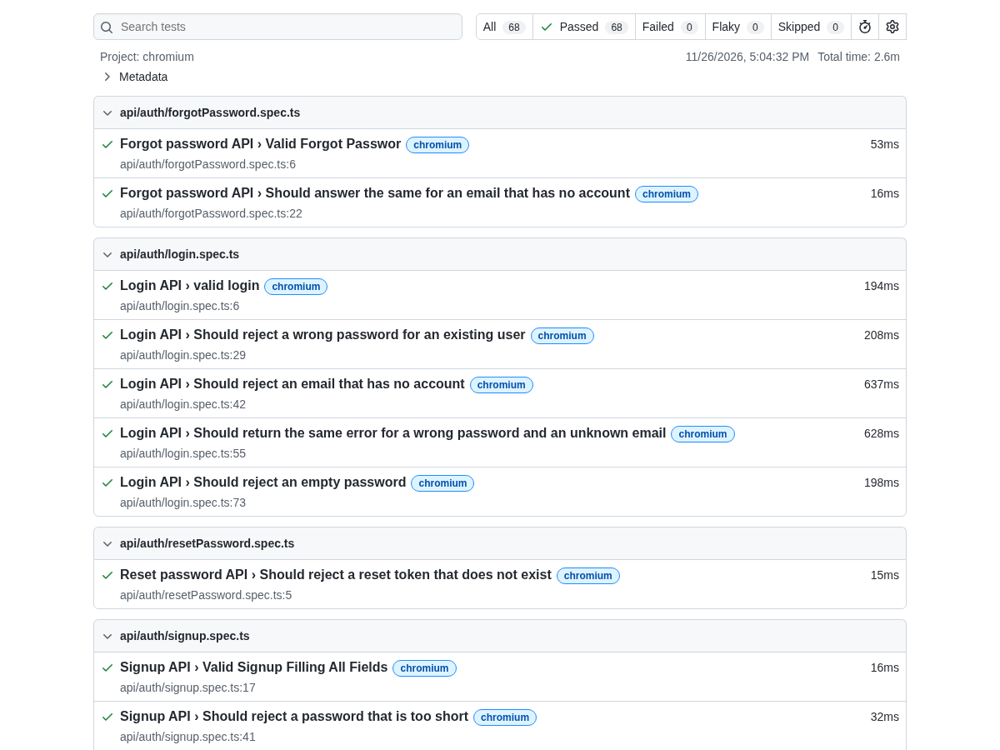

# Vendure-Testing

Playwright + TypeScript test suite for a Vendure shop: UI tests against the Next.js storefront and API tests against the Shop GraphQL API.

## What is mine and what is not

Everything under `tests/`, `pages/`, `api-clients/`, `fixtures/`, `types/`, `test-data/` and `.github/` is my own work: the test framework, the tests and the CI pipeline.

`storefront/` is **not** my product. It is the open source Vendure Next.js starter (created with `@vendure/create`), kept here only so CI can run the tests against it. My only changes to it are `data-testid` attributes the tests use. The Vendure server is the unmodified starter too.

*Playwright HTML report from a green CI run: 68 passed, 0 failed, 0 flaky.*

## Tech stack and requirements

- Playwright Test 1.64.1 (`@playwright/test`), TypeScript, `dotenv` 18.0.8. Versions are the ones in `package-lock.json`.
- Storefront under test: Next.js 16.3.0 with React 19.2.8 (from `storefront/package-lock.json`).
- Node.js 22 (the version CI uses) and npm. A Vendure server and the storefront must be running before the tests start.

## Structure

- `pages/` page objects, one class per page (`CartPage`, `CheckoutPage`, `ProductsPage`, ...). Locators are private, tests call methods.
- `api-clients/` one class per GraphQL area (`CartApiClient`, `CheckoutApiClient`, `ShopApiClient`, ...). The session token comes from the `vendure-auth-token` response header.
- `types/` types for page data and GraphQL responses.
- `fixtures/` Playwright fixtures that create the page objects and API clients.
- `tests/ui/` browser tests. `tests/api/` GraphQL tests.
- `storefront/` storefront files overlaid on the Vendure shop in CI (holds the `data-testid` attributes the tests use).

## Coverage

- Cart UI: add, quantity, remove, totals, promotion code, empty cart.
- Cart API: add, adjust, remove, totals, invalid input.
- Checkout API: shipping and payment methods, address, order transitions, payment errors.
- Checkout UI: field validation, empty cart redirect, guest order and logged in order to the confirmation page. The storefront always sends a successful payment, so declined and failed payments are covered in the API tests only.
- Auth API: wrong password, unknown user, empty password, weak password, no email leak on signup and forgot password, invalid reset token.
- Auth UI, products, product details and sorting.

## Known bugs the tests document

- `registerCustomerAccount` accepts an email with no `@` and returns success. The test for it is marked `test.fail`, so it passes while the bug exists and turns red when the bug is fixed.

## Run locally

1. Start a Vendure server (port 3000) and the storefront (port 3001). These are the same steps CI runs in `.github/workflows/playwright.yml`:
   - `npx @vendure/create shop --ci --storefront nextjs --db sqlite --use-npm` in an empty folder.
   - Copy this repo's `storefront/` over `shop/apps/storefront/`, without `.env*`, `node_modules` and `.next`.
   - `npm run dev:server` in `shop/apps/server`, and `npx next dev --port 3001` in `shop/apps/storefront`.
   - Create the login test user `testing@testing.com` with `.github/scripts/seed-user.sh` (needs `curl`, `jq` and `SIGNUP_PASSWORD` set).
2. `npm ci && npx playwright install chromium`
3. Create `.env` (never commit it) with these variables:
   - `SIGNUP_PASSWORD`: the password used when the tests sign up users. Use the same value for the seeded user above. Pick your own, nothing secret is stored in the repo.
   - `BASE_URL`: optional, defaults to `http://localhost:3001/en`.
4. `npx playwright test` (all), `npx playwright test tests/api` (API only), `npx playwright test tests/ui` (UI only).

## CI

Every run uploads the Playwright HTML report as the `playwright-report` artifact (kept 30 days). Open any run on the [Actions page](https://github.com/karimselim/Vendure-Testing/actions/workflows/playwright.yml), scroll to "Artifacts", download it and open `index.html`. Failed tests also keep a screenshot, video and trace.

`.github/workflows/playwright.yml` runs on pushes to `main`, `master` and `ci/**`. It starts Vendure and the storefront, then runs the suite.
